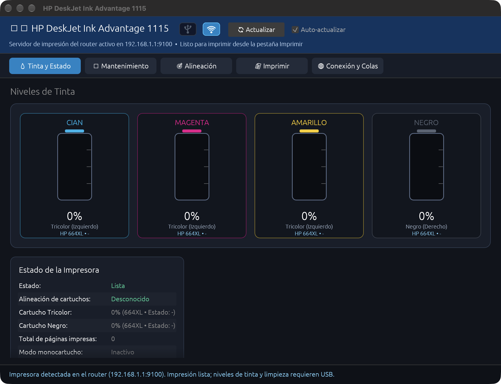

<p align="center">
  
</p>

# HP DeskJet Ink Advantage 1115 — Native macOS Driver & Control Center

Native **Rust** driver, **CUPS raster filter (`rastertohp1115`)**, CLI utility, and **`egui`/`eframe` GUI Control Center** for the **HP DeskJet Ink Advantage 1115** (`DeskJet 1110 series`, Product `F5S21A`, USB `0x03f0:0xdf11`) on **macOS (Apple Silicon)**.

Designed to give full printing, telemetry, and maintenance control on modern macOS without bloated vendor suites—including direct USB LEDM communication, PCL3GUI Mode 10 printing, composite CMY black support, and router TCP port `9100` printing.

<p align="center">
  
</p>

---

## Features

- **Real-Time Telemetry & Ink Gauges (USB LEDM)**:
  - Direct USB communication with HP LEDM XML endpoints (`/DevMgmt/ConsumableConfigDyn.xml`, `/DevMgmt/ProductStatusDyn.xml`, `/DevMgmt/ProductConfigDyn.xml`, `/DevMgmt/ProductUsageDyn.xml`) plus IEEE 1284 `GET_DEVICE_ID` fallback.
  - Visual per-channel gauges (`Cyan`, `Magenta`, `Yellow`, `Black`) with honest handling for refilled **HP 664** cartridges (`refilledBlack` / `unknown` chip state).
- **Printhead & Roller Maintenance with Live Progress**:
  - Level 1 & Level 2 printhead cleaning (`cleaningPage`, `cleaningPageLevel2`), paper feed roller cleaning (`paperFeedCleaningPage`), rib-smear cleaning (`ribSmearCleaningPage`), and internal diagnostics/usage pages.
  - Live progress bar, elapsed timer, and active printer polling until routine completion.
- **Cartridge Calibration / Alignment**:
  - Firmware calibration status (`/Calibration/State`) and `/Calibration/Session` completion (`CalibrationValid`) to clear `CalibrationRequired` alerts.
- **Native PCL3GUI Mode 10 Printing (PDF, PNG, JPEG)**:
  - Converts PDFs (with page ranges like `1-16` or `1,3,5-8`) and images via Ghostscript `chp2200` (PCL3GUI Mode 10) with USB backchannel draining and flow control.
  - **Composite CMY Black mode** (`--cmy-black` / GUI option): lets you print black text and grayscale using only the Tricolor (`CMY`) cartridge (`-dPapertype=3` / `ESC&l3M`) when the black cartridge has issues.
- **Automatic Router / Network Port `9100` Detection**:
  - Automatically detects USB print servers exposed by home routers (e.g., `192.168.1.1:9100`) and displays connection status indicators (USB vs Network/Wi-Fi) in the header with capability tooltips.
- **Native macOS CUPS Filter (`rastertohp1115`)**:
  - Includes a CUPS filter binary and PPD generator so macOS apps can print through standard Print dialogs (both direct USB and router `socket://` queues).
- **One-Command `.app` Bundle Packaging**:
  - [`build-app.sh`](build-app.sh) compiles `--release`, generates a `.icns` icon, embeds both binaries inside `HP DeskJet 1115.app`, and applies an ad-hoc macOS code signature.

---

## Requirements

- **macOS** on Apple Silicon (`aarch64-apple-darwin`) or Intel macOS
- **Rust toolchain** (`cargo`, `rustc`, edition 2024)
- **Homebrew** dependencies:
  ```zsh
  brew install libusb ghostscript
  ```

> **Note:** [`build.rs`](build.rs) links against `/opt/homebrew/lib/libusb-1.0.dylib`, and Ghostscript (`/opt/homebrew/bin/gs`) is required at runtime for PDF and PCL3GUI Mode 10 rendering. If you run on Intel macOS where Homebrew is under `/usr/local`, update the paths in [`build.rs`](build.rs) and [`src/pcl.rs`](src/pcl.rs).

---

## Build & Package Instructions

### 1. Clone the repository
```zsh
git clone https://github.com/luisfelipe18/hp-deskjet-ink-advantage-1115-macos.git
cd hp-deskjet-ink-advantage-1115-macos
```

### 2. Build Release Binaries
```zsh
cargo build --release
```
This builds:
- `target/release/hp-deskjet-1115` — GUI Control Center + CLI
- `target/release/rastertohp1115` — macOS CUPS raster-to-PCL3GUI filter

### 3. Build the macOS `.app` Bundle
```zsh
./build-app.sh
```
This creates **`HP DeskJet 1115.app`** in the repository root.

To also install it directly into `/Applications`:
```zsh
./build-app.sh --install
```

Launch the app from Finder, Spotlight, or Terminal:
```zsh
open "HP DeskJet 1115.app"
```

---

## CLI Usage

```zsh
# Query USB or router status, ink levels, firmware, calibration state, and page counters
./target/release/hp-deskjet-1115 --status

# Run maintenance (1 = Clean L1, 2 = Clean L2, 3 = Paper Feed, 4 = Rib Smear)
./target/release/hp-deskjet-1115 --clean 1

# Print a PDF page range directly via USB
./target/release/hp-deskjet-1115 --print document.pdf --pages 1-5

# Print using Composite CMY Black (Tricolor C+M+Y ink only, no black cartridge)
./target/release/hp-deskjet-1115 --print document.pdf --cmy-black

# Print over a router USB print server (TCP port 9100)
./target/release/hp-deskjet-1115 --net 192.168.1.1:9100 --print document.pdf --pages 1-3

# Cancel stuck jobs & send USB soft reset
./target/release/hp-deskjet-1115 --cancel-jobs

# Install the native CUPS filter & PPD in macOS
./target/release/hp-deskjet-1115 --install-cups
```

---

## Project Architecture

```text
├── Cargo.toml                 # Crate manifest and dependencies
├── build.rs                   # Links libusb-1.0 from Homebrew
├── build-app.sh               # Builds release binaries, icon, and signed macOS .app bundle
├── docs/images/               # App icon and UI screenshots
└── src/
    ├── main.rs                # egui Control Center GUI & clap CLI
    ├── usb.rs                 # libusb-1.0 FFI, IEEE 1284 Device ID, LEDM HTTP-over-USB, print streaming
    ├── ledm.rs                # LEDM XML parsers, maintenance triggers, and calibration state machine
    ├── pcl.rs                 # PCL3GUI Mode 10 (gs chp2200), page ranges, and Rust test-page renderer
    ├── cups.rs                # CUPS PPD/filter installer, TCP 9100 router probe & streaming session
    └── bin/
        └── rastertohp1115.rs   # Native macOS CUPS raster filter binary
```

---

## Notes & Troubleshooting

- **Router USB Print Server (`port 9100`) vs Direct USB**: Routers sharing the printer on TCP port `9100` only bridge the print data interface. Printing works over the network, while ink level monitoring, head cleaning, and calibration require a direct USB connection to the Mac.
- **Refilled HP 664 Cartridges Showing `Unknown` / `0%`**: HP 664 cartridges use a one-way factory drop counter and do not contain a physical fluid level sensor. Once depleted, refilled cartridges stay flagged as `refilledBlack` / `unknown` in hardware; the app indicates this state directly instead of falsely implying an empty tank.

---

## License

This project is released under the [MIT License](LICENSE).
